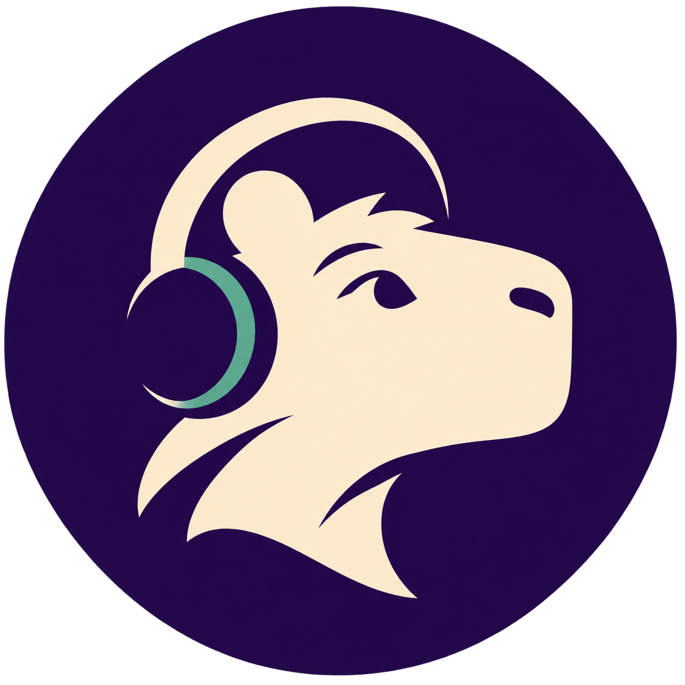

<p align="center">
  
</p>

<h1 align="center">Verso</h1>
<p align="center">Transcreva, revise e organize suas gravações no próprio computador.</p>
<p align="center">
  <a href="https://github.com/gnios/Verso/releases/latest"><strong>Baixar o Verso</strong></a> ·
  <a href="#primeira-transcrição">Primeira transcrição</a> ·
  <a href="#como-apoiar-o-verso">Como apoiar</a>
</p>

O Verso é um aplicativo desktop em português para transformar entrevistas, aulas e outras gravações em texto. Você pode ouvir a gravação enquanto revisa a transcrição, identificar quem está falando e exportar o resultado como texto ou legenda.

**Stack:** .NET 10 · Photino.NET (WebView2 / WebKitGTK / WKWebView) · EF Core 10 + SQLite · whisper.net 1.9.1 · NAudio · **UI em React 19 + Astryx** (design system da Meta, em `ui/`)

## UI — React + Astryx

A UI Blazor foi substituída por uma SPA **React 19 + [Astryx](https://github.com/meta/astryx)** (`@astryxdesign/core` + tema `neutral`). O shell Photino carrega `http://127.0.0.1:{port}/` (LocalAppServer serve o build em `wwwroot`), e o React fala com o backend .NET por uma **ponte nativa** (`window.external.sendMessage` ⇄ `SendWebMessage`) — sem HTTP para a lógica do app; áudio continua pelo LocalMediaServer (com Range).

```
ui/                       SPA React + Vite + TypeScript + Astryx
ui/src/lib/bridge.ts      cliente da ponte (invoke/onEvent; mock no navegador)
ui/src/astryx-themes.ts   tema (gerado por `astryx theme add`)
src/Verso.App/Services/NativeBridge.cs   protocolo JSON request/response + eventos
src/Verso.App/Services/VersoBridge.cs    métodos da aplicação expostos ao React
src/Verso.App/Services/LocalAppServer.cs servidor HTTP estático do wwwroot
```

**Build da UI (antes de `dotnet build`/`dotnet run`):**

```bash
cd ui
npm install
npm run build        # tsc --noEmit + vite build → src/Verso.App/wwwroot
```

**Dev da UI no navegador** (mock embutido, sem o app desktop): `cd ui && npm run dev` → http://localhost:5173. O guia do Astryx para agentes está em `ui/AGENTS.md` (use `npx astryx component <Nome>` para props de qualquer componente).

**Métodos da ponte** (ver `VersoBridge.cs`): `app.info`, `theme.get/toggle`, `sidebar.load`, `navigation.navigate`, `dashboard.load/action/search`, `transcription.action`, `ui.confirm.respond`, `upload.pickFile/selectFile/load/start`, `recording.*`, `editor.load/saveText/split/merge/assignSpeaker/addSpeaker/updateMeta/export`, `settings.load/update/verifyRuntime`, `folder.load/create/update/delete`, `feedback.send`. Eventos push: `navigation.changed`, `theme.changed`, `ui.confirm`, `dashboard.changed`, `dashboard.progress`, `folder.changed`, `queue.status`, `model.download.*`, `media.command`. A verificação E2E da ponte e das telas via CDP do WebView2 está em `scripts/verify-bridge.mjs` — `scripts/run-ui-checks.ps1` executa o fluxo inteiro (build → seed → app com CDP → checks).

Todas as telas estão portadas: **Dashboard, Upload, Gravação, Configurações, Pastas e Editor** (player, segmentos editáveis, locutores, split/merge, tags, export TXT/SRT/VTT). A biblioteca tem visualização em **tabela** (padrão) e **cartões**, alternável no cabeçalho e persistida em `localStorage`.

### Testes de interface e funcionalidade

| Comando | O que valida |
|---|---|
| `./scripts/run-ui-checks.ps1` | Fluxo completo: build UI + app, seed, sobe o app com CDP :9223 e roda `verify-bridge.mjs` (ponte JS⇄C# + DOM de todas as telas: tabela/cartões, upload, gravação, settings, pastas, editor). `-SkipBuild` para iterar rápido, `-RestartApp` para reiniciar um app aberto sem CDP |
| `python scripts/seed-test-transcription.py` | Semeia a transcrição E2E (`E2E — Entrevista de teste` + WAV). **Rode antes do verify** — os checks de editor mutam o banco |
| `node scripts/verify-bridge.mjs` | 40+ checks da ponte + telas contra um app rodando com `--remote-debugging-port=9223` |
| `node scripts/screenshot.mjs <saida.png>` | Screenshot da tela atual via CDP |
| `node scripts/debug-editor.mjs` | Sonda: cards do dashboard + operações do editor com o id semeado |
| `./scripts/run-e2e.ps1` | Testes Playwright (`tests/Verso.E2E`) — DOM real, lazy loading de mídia e Range requests |
| `dotnet test` | Suite completa (xUnit + E2E) |

## Instalação

Baixe a versão mais recente nas [releases do Verso](https://github.com/gnios/Verso/releases/latest). Os pacotes já incluem o runtime .NET.

- **Windows 10/11 x64 (`win-x64`)** — execute o `*-setup.exe` para instalar sem administrador ou extraia o ZIP e abra `Verso.App.exe`. O aplicativo usa o Microsoft Edge WebView2.
- **Linux x64 (`linux-x64`)** — extraia o ZIP e execute `./Verso.App`. Instale o WebKitGTK da sua distribuição, como `libwebkit2gtk-4.1-0` no Ubuntu ou Debian.
- **macOS Apple Silicon (`osx-arm64`)** — extraia o ZIP e execute `./Verso.App`. O aplicativo usa o WKWebView do sistema.

A variante **CPU** funciona sem aceleração gráfica. A variante **GPU** oferece CUDA ou Vulkan no Windows e no Linux, e Core ML no macOS.

## Primeira transcrição


1. Importe uma gravação de áudio ou vídeo ou grave pelo microfone.
2. Aguarde o download do modelo no primeiro uso. Acompanhe a transcrição na fila.
3. Abra o resultado no editor e use o player e a forma de onda para conferir trechos. Use a detecção automática de locutores e ajuste as atribuições por segmento.
4. Organize o material em pesquisas e tags. Exporte em **TXT** para trabalhar com o texto ou em **SRT** e **VTT** para usar como legenda.

<br clear="all">

> [!TIP]
> Para começar, use um arquivo WAV PCM. Para MP3, MP4 e outros formatos, instale o FFmpeg e deixe-o disponível no PATH.

### Modelos e dados

Em **Configurações**, você pode escolher entre dois motores de reconhecimento.

- **Parakeet** usa o modelo **pt-BR TAGARELA** por padrão. Também oferece o **TDT v3** para português, inglês e espanhol.
- **Whisper** oferece os perfis **Rápido**, **Equilibrado** e **Preciso** para ajustar o tempo de processamento e a precisão.

O reconhecimento roda localmente. Nos pacotes ZIP e EXE, o banco SQLite, as mídias, os modelos e os logs ficam em `data/`, ao lado do executável. No MSIX, ficam em `%LOCALAPPDATA%\Gnios\Verso\data`. Os pacotes das GitHub Releases atualizam os binários e preservam a biblioteca local.

## Como apoiar o Verso

- **Divulgue.** Compartilhe o Verso com quem trabalha com entrevistas, aulas ou pesquisa. Você também pode dar uma estrela no GitHub.
- **Conte como foi usar o app.** Abra uma [issue](https://github.com/gnios/Verso/issues) para sugerir melhorias ou relatar problemas. Em um relato de erro, inclua a versão do Verso, o sistema operacional e os passos para reproduzir o problema. Se precisar anexar uma gravação, use uma amostra que possa ser compartilhada publicamente.
- **Contribua com código ou documentação.** Abra um pull request com uma descrição da mudança e de como você a testou. Para propor uma mudança maior, abra uma issue para conversar sobre a ideia.

### Rodar o projeto para contribuir

Instale o **SDK do .NET 10** e o runtime WebView da sua plataforma. Na raiz do repositório, execute os comandos abaixo.

```sh
dotnet restore
dotnet run --project src/Verso.App
dotnet test tests/Verso.Tests
```

Veja a [documentação técnica](DOCS.md) para entender a estrutura do código e o [guia de testes de ponta a ponta](tests/Verso.E2E/README.md) para validar os fluxos da interface.
