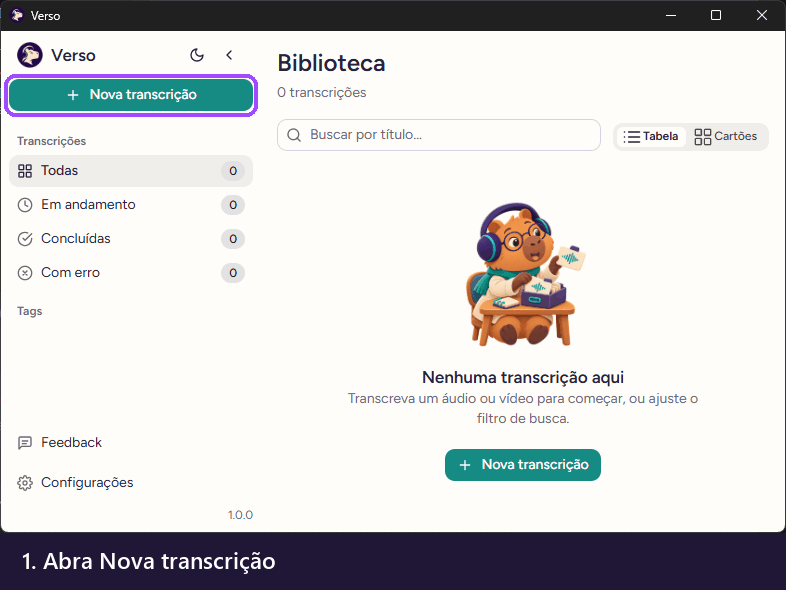

<p align="center">
  
</p>

<h1 align="center">Verso</h1>
<p align="center">Transcreva, revise e organize suas gravações no próprio computador.</p>
<p align="center">
  <a href="https://github.com/gnios/Verso/releases/latest"><strong>Baixar o Verso</strong></a> ·
  <a href="#primeira-transcrição">Primeira transcrição</a> ·
  <a href="#como-apoiar-o-verso">Como apoiar</a>
</p>

O Verso é um aplicativo desktop em português para transformar entrevistas, aulas e outras gravações em texto. Você pode ouvir a gravação enquanto revisa a transcrição, identificar quem está falando e exportar o resultado como documento acadêmico, texto simples ou legenda.

## Instalação

Baixe a versão mais recente nas [releases do Verso](https://github.com/gnios/Verso/releases/latest). Os pacotes já incluem o runtime .NET.

- **Windows 10/11 x64 (`win-x64`)** — execute o `*-setup.exe` para instalar sem administrador ou extraia o ZIP e abra `Verso.App.exe`. O aplicativo usa o Microsoft Edge WebView2.
- **Linux x64 (`linux-x64`)** — extraia o ZIP e execute `./Verso.App`. Instale o WebKitGTK da sua distribuição, como `libwebkit2gtk-4.1-0` no Ubuntu ou Debian.
- **macOS Apple Silicon (`osx-arm64`)** — extraia o ZIP e execute `./Verso.App`. O aplicativo usa o WKWebView do sistema.

A variante **CPU** funciona sem aceleração gráfica. A variante **GPU** oferece CUDA ou Vulkan no Windows e no Linux, e Core ML no macOS.

## Primeira transcrição


1. Abra **Nova transcrição**, clique em **Selecionar arquivo** e escolha uma gravação. Confira o título preenchido e clique em **Transcrever**. Você também pode gravar pelo microfone.
2. Aguarde o download do modelo no primeiro uso. Acompanhe a transcrição na fila.
3. Abra o resultado no editor e use o player e a forma de onda para conferir trechos. Use a detecção automática de locutores, ajuste as atribuições por segmento e renomeie quem está falando.
4. Organize a biblioteca com tags. No menu **Baixar** do editor, escolha **Documento acadêmico (RTF)**, **Texto (TXT)** ou legendas em **SRT** e **VTT**.

<br clear="all">

<details>
<summary>Ver como importar um áudio no Verso (GIF)</summary>



</details>

> [!TIP]
> Para começar, use um arquivo WAV PCM. Para MP3, MP4 e outros formatos, instale o FFmpeg e deixe-o disponível no PATH.

### Exportação acadêmica em RTF

O RTF editável inclui a identificação da gravação, as convenções de transcrição e as falas com locutor e marcação de tempo. As margens, a fonte Times New Roman 12 e o espaçamento 1,5 seguem a formatação da ABNT NBR 14724 para trabalhos acadêmicos. Você pode usar a transcrição como apêndice do trabalho.

### Modelos e dados

Em **Configurações**, você pode escolher entre dois motores de reconhecimento.

- **Parakeet** usa o modelo **pt-BR TAGARELA** por padrão. Também oferece o **TDT v3** para português, inglês e espanhol.
- **Whisper** oferece os perfis **Rápido**, **Equilibrado** e **Preciso** para ajustar o tempo de processamento e a precisão.

O reconhecimento roda localmente. Nos pacotes ZIP e EXE, o banco SQLite, as mídias, os modelos e os logs ficam em `data/`, ao lado do executável. No MSIX, ficam em `%LOCALAPPDATA%\Gnios\Verso\data`. Os pacotes das GitHub Releases atualizam os binários e preservam a biblioteca local.

## Como apoiar o Verso

- **Divulgue.** Compartilhe o Verso com quem trabalha com entrevistas, aulas ou pesquisa. Você também pode dar uma estrela no GitHub.
- **Conte como foi usar o app.** Abra uma [issue](https://github.com/gnios/Verso/issues) para sugerir melhorias ou relatar problemas. Em um relato de erro, inclua a versão do Verso, o sistema operacional e os passos para reproduzir o problema. Se precisar anexar uma gravação, use uma amostra que possa ser compartilhada publicamente.
- **Contribua com código ou documentação.** Abra um pull request com uma descrição da mudança e de como você a testou. Para propor uma mudança maior, abra uma issue para conversar sobre a ideia.

### Rodar o projeto para contribuir

Instale o **SDK do .NET 10** e o runtime WebView da sua plataforma. Na raiz do repositório, execute os comandos abaixo.

```sh
dotnet restore
dotnet run --project src/Verso.App
dotnet test tests/Verso.Tests
```

Veja a [documentação técnica](DOCS.md) para entender a estrutura do código e o [guia de testes de ponta a ponta](tests/Verso.E2E/README.md) para validar os fluxos da interface.

